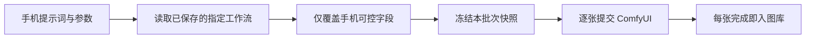

# 工作流实现与固定映射

只支持约定的四个工作流，不自动识别任意节点图。文件名和 ID 是接口约定；结构改变时同步更新 `computer/custom_nodes/comfy-mobile-batch/workflows.py` 与 Android `assets/workflows.json`。

| 模式 | 文件 | 输出 | 正向词入口 | 负向词 | 尺寸 | 种子 |
|---|---|---|---|---|---|---|
| 文生图 | 手机文生图.json | 50 | 80.text | 37.text | 10 | 41.noise_seed |
| 单图改图 | 手机图改图 (单图）.json | 29 | 123.text | 85.prompt | 82 | 53.seed |
| 双图改图 | 手机图改图 (双图）.json | 29 | 123.text | 85.prompt | 82 | 53.seed |
| Anima | 手机Anima文生图.json | 46 | 51.text | 12.text | 28 | 19.seed |

手机无第二张输入图时用 single，有第二张时用 dual。输入节点为 72 和 90。118 检测第一张原图宽高；扩展加入 `mobile_width`／`mobile_height` 数学节点，按比例乘后对齐到 8 像素，并传给输出 latent 尺寸。最小边 64。以 720×480 为例，2× 为 1440×960，0.8× 为 576×384。

Anima 的 UNET 节点 44 根据手机选项使用 `anima-base-v1.0.safetensors` 或 `anima-turbo-v1.1.safetensors`，采样器 19 分别覆盖为 32／4、10／1。画师节点 58 位于翻译检查 54 与正向编码 11 之间。其余参数保留电脑保存值。

解析器从输出节点反向遍历可达节点，跳过禁用／旁路节点；按输入 widget 索引读取保存值，并跳过种子的 fixed／randomize 等额外控制项；已连线输入保留链接，避免旧文本覆盖连线。每个新批次解析一次，配置快照不会在批次中途随保存操作改变。

手机覆盖：正／负向词、宽高或原图比例、上传图片、种子、批量数量。每个服务器 prompt 的 batch_size 设为 1，整批由扩展逐张执行；随机模式每张新种子，固定模式复用指定种子。未暴露给手机的翻译模型、LoRA、采样器等由电脑保存值决定。
